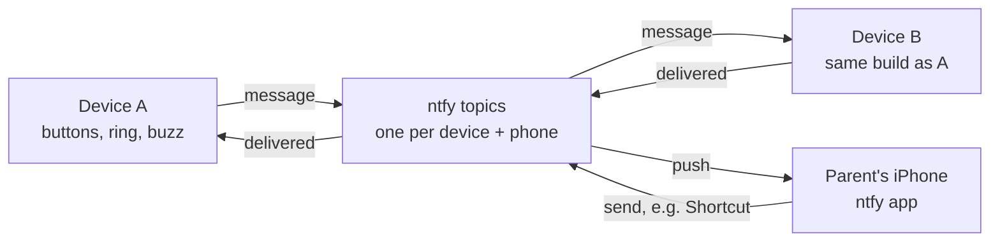

# Pebble Pager

A pair of palm-size pagers for kids on the Seeed XIAO ESP32-C3. This file is the project spec. Wiring and test steps: [docs/build-steps.md](docs/build-steps.md). Look and ring states: open [docs/concept.html](docs/concept.html) in a browser. AI tools: [AGENTS.md](AGENTS.md).

## Overview

Two matching palm-size devices, each built on a Seeed XIAO ESP32-C3, swap pulse messages over Wi-Fi through ntfy, a push notification service. A pulse message is a pattern of long and short button presses that plays back on the other device as light and buzz. The same service sends every message to a parent's iPhone and lets the phone send messages back. Parts run about $36 per device, or roughly $79 for the pair with breadboards and wire.

How one message travels:

1. Holding button 1 wakes the device and records a pattern of presses. It joins a saved Wi-Fi network and posts the pattern to the other device's ntfy topic and to the phone's topic.
2. The other device, listening on its topic, plays the pattern back as light and buzz, then posts "delivered" back.
3. The phone shows the message as a notification in the ntfy app.

Device A sending to B is shown; B's messages take the same paths in reverse. The phone can post to either device's topic, for example from an iPhone Shortcut.

Two trade-offs come with this design. It's Wi-Fi only, so it works on saved networks or a phone hotspot. And ntfy holds messages for a limited time: its docs say a couple of hours in one place and 12 hours by default in another. Plan on a couple of hours. A device off Wi-Fi longer than that can miss a message, though the phone still gets every one.

Also planned: remote firmware updates, offline queueing, a vibration motor, and three sleep modes to stretch the battery. Delivery within 30 s and a week of battery are estimates until the prototype is measured.

Out of scope: emergency alerts, location tracking, cellular, networks with login pages, and calling 911. It supplements a phone; it does not replace one.

## Behavior

Button 1 is large and does the everyday things: view and send. Button 2 is small and recessed, for the occasional ones. With nothing waiting, any press of button 1 is the start of a message, so a stray press in a bag sends a stray one-press message (see Risks).

### Quick reference

The same list is on the virtual pager page (`docs/virtual-pager.html`). A short, gentle buzz goes with every green flash and red signal, and the motor runs with every press, recorded or played.

| Function | How, and what you see |
|---|---|
| Power on | Press and hold button 2 for 5 seconds. A green light fills the ring. |
| Power off | Press and hold button 2 for 10 seconds. The ring fills purple, then red counts down; let go when it is dark. |
| Send a message | Press button 1 (a tap or a hold) and keep going with a pattern of long and short presses. Each press lights a comet in your color. The ring is dark while it sends (it is assumed to be sending). If the other device was not already in a conversation with you, a dim green fill then goes once round the ring while it connects (up to 45 s, as long as their device may take to wake and answer), finishes in a second when they answer, and ends with one green pixel flashing at the bottom: sent and received. Later messages in the conversation skip the fill: answers are instant. |
| Play a message | One pixel breathing at the top, in the sender's color, means a message is waiting. Press button 1 and it plays at once, in the sender's color. During a conversation it plays by itself. A message plays once: there is no replay. |
| Check battery and Wi-Fi | Tap button 2. The ring fills green to the battery level (red under 20%, one amber pixel if no battery is fitted), then blue to the Wi-Fi signal strength (two red pixels if not connected). |
| Wi-Fi setup | Hold button 2 for 5 seconds and let go when the ring is full purple. Do it again to close. |
| Something went wrong | Two red pulses: the message could not be sent, or was not received. A message that could not go is kept and retried. |
| Low battery | One amber pixel at the bottom, once a minute. |

While the device is off, button 1 does nothing.

Colors: the sender's color is one of Pink, Blue, Green, Purple, Orange, Teal, Yellow, Red, set on the setup page and sent with every message. The device's own status colors are fixed: **cyan** joining Wi-Fi, **green** message sent and received, battery level and turning on, **red** failed and the countdown to off, **purple** setup, **amber** low battery.

| Button | Press | What happens |
|---|---|---|
| 1, large | Tap, a message waiting | Wakes the device and plays the waiting message the moment the button goes down, in the sender's color. There is no replay. |
| 1, large | Tap or hold, nothing waiting | The first press of a message. Each further press within 0.5 s adds a pulse, and it sends 0.5 s after the last one. A single tap is a one-press message. |
| 1, large | Hold, messages waiting | Plays them all, then starts a fresh recording. |
| 2, small | Tap | Shows the battery level on the ring, then the Wi-Fi signal. |
| 2, small | Hold 5 s | The ring fills purple. Release to open Wi-Fi setup. |
| 2, small | Keep holding to 10 s | The ring turns red and counts down until it is dark. Release then to turn the device off. |
| 2, small | Hold 5 s, while off | Turns the device on. The ring fills green, the same meter as the other holds, and a shorter press does nothing. Button 1 does nothing while it is off. |

With nothing waiting, a recording starts with any press of button 1, short or long, and that press is the first press of the message, even when it is the press that wakes the device from sleep. Further presses, short or long, add to it, and it is sent half a second after the last one, so a pause of half a second or more ends the message; a single hold on its own is a one-press message. The one exception: if unread messages are waiting, the hold plays them all first and then starts a fresh recording, so that hold is not part of the message (and if nothing is pressed in the next half second, nothing is sent). A press has to last 75 ms (`MIN_PRESS_MS`) to count: a lighter touch is a bump and is ignored, which a quick deliberate tap, at about 80 to 150 ms, still clears. A press with unread messages waiting plays all of them, oldest first, once it has lasted that long, each in its sender's color, without waiting for the release: a tap is then over, and a hold carries on to a fresh recording. A new press while they play cuts them short and starts a recording: you are answering, and what had not played stays unread. A message plays once and is gone, so there is no replay. A tap with nothing waiting no longer checks the inbox: it is the start of a message, and the inbox is read right after it is sent. The inbox is never read during a recording, so press timing stays exact, but it is read as soon as the recording ends. A message is at most 12 presses or 15 seconds, and a press counts as at most 5 seconds; at either limit it is sent at once, the press in progress is cut short, and the button is ignored for 2 seconds so spill-over presses are not taken as taps. A second 5-second hold on button 2 closes the setup page. These values are starting points to tune.

A message waits for a tap: when it arrives, the ring only shows that it is waiting, at every check, until button 1 plays it. The exception is a conversation. Sending a message starts one, and so does playing one you received; it lasts 2 minutes (`CONVERSATION_S`) from the last message sent, played or received. During a conversation a message that arrives plays at once, light and buzz, and counts as played. The device also stays awake and connected to Wi-Fi with its inbox held open as a stream, so a reply, or the receipt for a message just sent, is here the moment it is posted and not at the next 30 s check. When the 2 minutes are up it closes the stream and goes back to sleeping between checks. A message that arrives outside a conversation does not start one: it waits for its tap. A new press while a message plays cuts it short and starts a recording (a finger already down from the press that started it does not count).

The motor runs gently (`MOTOR_STRENGTH`, 100 of 255 to start) and never for long: with the comet, for each press of button 1 while recording and each press of a message being played, and for a short buzz with every green flash and every red signal. With the comet it sways a little stronger and softer once each lap (`MOTOR_SWAY`, up to 40 more), following the head round the ring, and fades out over 0.5 s when the press ends (`MOTOR_FADE_MS`).

Presses and releases are caught by interrupts and time-stamped, so the recorded lengths are exact even while the device is busy with the network, and no network work starts while a button is in use.

| Ring and buzz | Meaning |
|---|---|
| A comet in the sender's color, with a buzz for each press | A message playing: on a tap, or on arrival during a conversation |
| One pixel at the top breathing once in the sender's color | A message is waiting to be viewed (at each 30 s check) |
| A comet in the device's own color while button 1 is held | Recording |
| Cyan chase (two dots circling) | Joining Wi-Fi after switching on |
| A dim green fill, once round the ring over up to 45 s | Connecting: the first message is out and the other device has not answered yet. It finishes in 1 s on the answer, then the green flash. Any press, or any button 2 action, takes over the ring; the fill keeps time and returns after a press |
| One green pixel flashing at the bottom, with a short buzz | Message status: sent and received |
| Two red pulses with a short buzz | Couldn't send (queued to retry), or sent but no receipt came back in 45 s |
| 1 to 12 pixels filling for 2 s, green (red under 20%; one amber pixel with no battery) | Battery level, after a button 2 tap |
| Then 1 to 12 pixels in blue (two red ones if not connected) | Wi-Fi signal strength, straight after the battery level |
| Amber blink at the bottom every 60 s | Battery under 20% |
| Purple, filling; then solid and dim | Holding for setup; then the setup page is open |
| Red, counting down to dark | Still holding, towards "off" |

### The ring's animation

The ring is the device's face, so its motion is designed to be smooth and a little playful. `firmware/pebble-pager/ring.h` is the engine, and `docs/ring-engine.js` is a copy of the same math that the virtual pager runs in a browser. To tune a level, change `ringTune` in `ring.h` and in `ring-engine.js`.

- **The comet.** A head in the sender's color with a tail that melts into white, gliding between pixels so it never jumps. It is the only message animation: recording and playback are computed from the same press times, so both devices show the same thing.
- **A press is a key on a synth.** Button down fades the comet in over about half a second, and it is orbiting, tail and all, from the first instant (the tail is full length by a third of the way through the fade, so the chase never waits for the light); it orbits for as long as the button is held, starting at 0.9 laps per second and gaining 0.2 each second up to 1.9; release fades it out towards white as it coasts. It carries on from where it stopped, so a long message travels round the ring.
- **The playfulness is in the motion, not the brightness.** On a press the head leaps about a pixel ahead and springs back, stretching the tail; on a release it kicks back and the tail squashes. Brightness only fades smoothly, because the head is already at full and an overshoot there would not show.
- **Not received.** Two soft red pulses with a short buzz: when a message just recorded can't be sent (no network, or ntfy refused it; it stays queued and later tries are silent), and when no receipt comes back in the 45 s window.
- **Message waiting.** One pixel at the top breathes once at each wake, in the color of whoever sent the waiting message (the oldest one, if several are waiting), not the device's own color. It starts as the device wakes, alongside the Wi-Fi join, so it adds no time awake. A message that has just come in lights it at once, as the inbox is read and before the receipt is posted, so it shows about when the sender sees "received", and the device stays awake until it has finished.
- **Status lights.** Everything else uses the device's own fixed colors and a plainer motion, so it is never mistaken for a message. A message has one status, shown once: green (one pixel flashing at the bottom, and a short buzz) means it was sent and received; red (two pulses and a short buzz) means it failed to send or was not received. Nothing shows while a message is on its way: it is assumed to be sending, and the ring is dark until that status appears. The one exception is the first message to a partner whose device may be asleep (nothing heard from them in the last two minutes): after it is posted, a dim green *connecting* fill goes once round the ring, timed to the 45 s the wait can take, and is gone once they answer. It finishes in a second, the green flash follows, and from then on replies are live and instant. A reply from them counts as the answer as well. A press (the comet, a played message), and every button 2 action (which also cancels it), takes over the ring; the fill keeps time underneath and comes back after a press. If the sending itself fails, or no answer comes in 45 s, it gives way to the red pulses. The red pulses are as dim as the other status lights (`fail` and `connect` in `ring.h`'s tuning). A *chase* is two cyan dots circling while the device joins Wi-Fi after being switched on. A *meter* lights pixels from the top, clockwise, the last one partly so it glides: the battery level and then the Wi-Fi signal after a tap of button 2 (each fills, holds 2 s and fades; green or red, then blue or red), and button 2's hold. The low-battery blink is the waiting light's twin, amber and at the bottom, and the green received flash is a third: the same single-pixel breath, told apart by its color, its place and the buzz (the waiting light has none). The device's colors are fairly saturated on purpose, so they read at a glance through the diffuser: the eight sender colors have little white in them, and the ring's white LED only adds a share of it (`pastel` in `ring.h`).
- **Button 2's hold.** (While the device is off, holding it fills the same meter in green for 5 s, which turns the device on.) Nothing shows for the first 0.4 s, so a tap stays dark until the battery level appears. Then the ring fills purple, reaching full at 5 s; it stays full for 0.8 s, then turns red and counts down to dark at 10 s. Releasing anywhere from full purple to the last red pixel opens setup; releasing after it is dark turns the device off. While the setup page is open the whole ring glows dim purple.
- **Brightness and power.** There is no fixed brightness cap. Each frame's current is added up and the frame is dimmed as a whole only if it would pass the budget (180 mA to start), so a few lit pixels can be bright and fades have the full range of steps. The comet draws about 75 to 100 mA at its brightest; only the full-ring red pulse reaches the budget.
- **On the hardware.** `output.h` drives the pixels and the motor from a small task that runs about 60 times a second, so the light keeps moving while the main loop waits on a network request. The comet follows button 1 straight from the pin. The motor runs with each press, recorded or played, and for the short buzzes, at part power: its pin is switched at 20 kHz. The task runs above the Wi-Fi driver's tasks, which otherwise take the single core for the first second or two of a wake while Wi-Fi starts and joins, and made the first animation stutter; `status` reports the longest gap between frames and when in its wake it came. The ring's power (D5) is on only while something is lit, and the device does not sleep until the ring is dark and the motor still.
- **Not run on the parts yet.** All of the ring, motor and battery code compiles and its animation math is checked against the browser copy, but none of it has driven a real ring, motor or battery. Brightness, colors and buzz lengths are first guesses to tune on the hardware (`show received|failed|waiting|low` and `battery` on the serial console show each one).

## Parts list

A breadboard prototype of both devices, batteries included, costs about $79 in parts. The final-build extras add about $13. Prices marked "est." are estimates; the rest were checked on the seller's page.

| Part | Qty for the pair | Price | Used in |
|---|---|---|---|
| [Seeed XIAO ESP32-C3](https://www.seeedstudio.com/Seeed-XIAO-ESP32C3-p-5431.html), pre-soldered pins | 2 | $4.99 each (bare board) | Every step |
| Half-size breadboard | 2 | about $5 each, est. | Prototype |
| Male-to-male jumper wire kit | 1 | about $5, est. | Prototype |
| [6 mm tactile buttons, 20-pack](https://www.adafruit.com/product/367) | 1 | $2.50 | Step 3 |
| [NeoPixel Ring, 12 RGBW pixels, natural white (about 4500 K)](https://www.adafruit.com/product/2852) | 2 | $9.50 each | Step 4 |
| 1000 µF capacitor, 6.3 V or higher | 2 | about $1 each, est. | Step 4 |
| PN2222A transistor | 4 | about $2 total, est. | Steps 4 and 5 |
| [Vibrating mini motor disc](https://www.adafruit.com/product/1201) | 2 | $1.95 each | Step 5 |
| 1N4148 diode | 2 | under $1, est. | Step 5 |
| Resistor assortment with 330 Ω, 470 Ω, 1 kΩ, 10 kΩ and 220 kΩ | 1 | about $6, est. | Steps 4, 5 and 8 |
| 0.1 µF ceramic capacitor (optional) | 2 | under $1, est. | Step 8 |
| [LiPo 3.7 V 2,000 mAh, JLJLUP, with protection circuit and PH 2.0 plug](https://www.amazon.com/dp/B0FH7H4Z7W) | 2 | $9.99 each, or $16.99 for two | Step 8 |
| JST-PH 2-pin socket cable | 2 | about $1 each, est. | Step 8 |
| Enclosure, 3D printed | 2 | $3–5 each, est. | Final build |
| M2.3 low-profile (wafer head) self-tapping screws: 4 × 5 mm to hold the board, 4 × 10 mm to close the case | 16 | about $3, est. | Final build |
| Thin silicone wire (30 AWG or so) and perfboard: stock 40 × 60 mm, 14 × 20 holes, double-sided, plated-through | 1 set | about $2, est. | Final build |

The battery measures 53 × 34 × 10 mm (its listing says 52 × 34 × 10), has a built-in protection circuit, and comes with a PH 2.0 plug on a 70 mm lead. Its seller warns that the plug's polarity is not standard, so check it as step 8 describes before connecting anything. The case is sized around this cell: a different one needs the case checked again. The ring is 36.8 mm across and 3.25 mm thick, with a 23.3 mm center hole for the send button, so the same part serves the prototype and the final build. There is no power switch: the device turns off from button 2, and the case should leave a pinhole over the XIAO's RESET button.

## Wiring and pin plan

Both buttons sit on GPIO0–5, which can wake the chip from deep sleep. Boot-mode pins (D0, D8, D9) and serial pins (D6, D7) are unused.

| Connects to | XIAO pin | GPIO | How |
|---|---|---|---|
| Battery sensor | D1 (A1) | 3 | Midpoint of two 220 kΩ resistors from battery + to GND |
| Button 1, large: view and send | D2 | 4 | Button to GND, internal pull-up |
| Button 2, small: battery, setup, off | D3 | 5 | Button to GND, internal pull-up |
| Vibration motor | D4 | 6 | 1 kΩ to a PN2222A base, 10 kΩ from base to GND |
| Ring power switch | D5 | 7 | 470 Ω to a second PN2222A base, 10 kΩ from base to GND |
| Ring data | D10 | 10 | Through 330 Ω to DIN |
| Ring +, motor + | 3V3 | — | The + power rail |
| Battery | BAT+ / BAT− pads underneath | — | Through the JST socket |
| Left empty | D0, D6, D7, D8, D9 | 2, 21, 20, 8, 9 | Boot-mode and serial pins |

- The board can't report its own battery level, so a half-voltage divider on D1 measures it (Seeed's guide uses 200 kΩ; this uses 220 kΩ). It draws about 10 µA.
- D0 (GPIO2) is a boot-mode pin that must be high at startup; a button holding it low could stop the board from starting.
- D3 (GPIO5) can't take reliable analog readings but works as a button input.
- A 10 kΩ from each transistor base to ground keeps the motor and ring off while the chip sleeps or starts.
- The ring's transistor has a 470 Ω base resistor and the motor's a 1 kΩ. A PN2222A is only sure to switch fully on when its base gets a fair share of the current it carries; the ring can draw up to 180 mA and the motor 60 mA, so the ring's base needs about twice the drive (5.5 mA against 2.6 mA).
- The battery sensor's two 220 kΩ resistors are a weak source for the chip's analog input. The firmware averages 16 readings, as Seeed's guide does; an optional 0.1 µF capacitor from D1 to ground steadies it further.
- The ring's SK6812 RGBW pixels are rated 5 V but run from 3V3 here, matching the XIAO's 3.3 V data signal. Colors may look dimmer or shifted; if so, power the ring from battery + instead.
- A full ring could draw over 800 mA (12 pixels × 4 LEDs × about 18 mA), but the 3V3 pin is rated 700 mA in one place on Seeed's page and 500 mA in its specification table, with Wi-Fi peaking at 335 mA and the motor at 60 mA. Wi-Fi, a ring at its budget and the motor together come to about 575 mA, over the lower figure if all three peak at once: lower `budgetMa` in `ring.h` if the board resets or the ring flickers while it is lit. The firmware keeps every frame inside a 180 mA budget (see "The ring's animation"); the hardware checks use a fixed brightness of 30 of 255.
- The ring's transistor switches its ground side. While the ring is off, a data pin held low would give the pixels a path to ground through the 330 Ω resistor, so the firmware releases the data pin whenever it cuts the ring's power. To confirm on the breadboard: with the ring dark, no pixel glows and the ring's ground wire carries no current.
- The ring pixel type must be four-channel GRBW, or colors come out scrambled.

## Power budget

A week on 2,000 mAh means averaging under about 9.5 mA (80% usable: 1,600 mAh over 168 h). Plan B gets built first because it works with the standard Arduino tools. Plan A lasts far longer but needs a different toolchain.

| Plan | How it receives | Average draw, est. | Battery life, est. | Receive delay |
|---|---|---|---|---|
| A: stay connected | Wi-Fi stays joined in light sleep and the server pushes messages | About 1.5 mA | About 44 days | A few seconds |
| B: wake and check | Deep sleep, wake every 30 s, connect, check, sleep | 3–9 mA | 7–21 days | Up to 30 s |
| Away: no saved network in range | Deep sleep, wake every 5 min for a quick scan, no connection attempt | Under 1 mA | Months | Nothing arrives until back on Wi-Fi |
| Off: button 2 held 10 s | Deep sleep with no timer; only a 5 s hold of button 2 wakes it | About 0.05 mA | Years | Nothing arrives until turned on |

**Sleep strategy.** On a saved network use plan B. With no saved network in range, switch to away mode. A button press wakes the device at once in every mode; in away mode a recorded message is queued if there's still no network. Back in range it rejoins within 5 minutes and collects messages ntfy still holds. The 5-minute interval is a starting value to tune; the away figure assumes a 2 s scan at about 80 mA.

- All figures are modelled (Espressif's documented currents plus Qoitech's bench measurements of XIAO boards), not measured. The prototype battery test decides.
- Plan A relies on Espressif's 1.4 mA connected light-sleep figure, which needs a router that signals every beacon and isn't in the standard Arduino libraries. Without it, staying connected draws about 21.5 mA (about 3 days). Reaching plan A means rebuilding the libraries with PlatformIO or using Espressif's own toolchain. Decide after measuring plan B.
- Plan B depends on radio-on time per check at about 90 mA: 3 s gives about 9 mA (7 days), 1 s gives about 3 mA (21 days). Remembering the router's channel and address between wakes is the main way to shorten it.
- Bench result for plan B (the firmware itself, on USB, bare board): on a quiet check the device is awake about 2.6 s, of which about 0.35 s is start-up, 1.7 to 1.9 s the fast join and 0.6 s reading the inbox. Only the time is measured; the current is not, and needs a meter or a battery run. A message for a sleeping device is received and answered in 21 to 28 s. Running at 80 MHz made each wake longer and was worse. A derived Wi-Fi key does not help. Reading the inbox over plain HTTP was tried and dropped: it saved only about 0.2 s per check (0.6 s to 0.4 s) and sent the topic name over the network in the clear.
- Sending, buzzing and lighting add little: the motor draws 60 mA and the ring is capped near the same, each for a second or two.
- Deep sleep measured 41.6 µA on a XIAO ESP32-C3 (Seeed lists 43 µA). The battery sensor adds about 10 µA.
- Measure on battery with USB unplugged; USB keeps the chip awake and inflates every reading.
- Charging: the XIAO's charger is listed at about 370 mA (Seeed doesn't state it), roughly 6 hours for 2,000 mAh. That is under a fifth of the cell's capacity per hour, a gentle rate; the listing gives no charge limit.
- NeoPixels draw current even when dark (up to about 1 mA per pixel, no datasheet figure), so the D5 transistor cuts ring power whenever it isn't showing something.
- To verify, post `battery on` to each device's inbox: it then reports its battery voltage to the phone every hour. Run it from full and count the days. `battery off` stops the reports.
- **Battery level.** D1 is read at every wake, before the radio starts (Wi-Fi pulls the voltage down while it transmits), averaged over 16 readings and doubled. The percentage comes from a table of a resting lithium cell's voltage (3.30 V empty, 3.79 V half, 4.20 V full; steep at both ends and flat through the middle), so it is only a guide under load, and reads high while charging. A reading under 2.5 V means no sensor is wired, and the device says "battery not connected" instead of a level. There is no per-device correction yet.

**How sleep works in the firmware.** Deep sleep restarts the program, so each wake is a fresh start that does one job and sleeps again.

- **Wake:** a timer every 30 s, or either button at once (only button 2, held, after "off"). After power-on or a restart it stays awake 30 s first.
- **A check:** rejoin the same access point with the same IP settings (no scan, no DHCP), read the inbox, act on what is there, sleep for what is left of the 30 s.
- **Stays awake while needed:** a button in use or a recording, 5 s after the last press, a message being posted, up to 45 s for a receipt, 2 minutes after the last message of a conversation (the inbox is held open as a stream), the setup page, an update, or 10 minutes after an `awake` command.
- **Away:** with no saved network in range it sleeps 10 s, then 20, 40 and so on up to 5 minutes between looks. A saved network that is in range but refuses the join is retried the same way, but never more than a minute apart: once, a plugged-in pager went about 10 minutes without reading its inbox while waiting out the away timing at home. With no networks saved at all it sleeps 5 minutes at a time; a button still wakes it.
- **Off:** button 2 held 10 s sleeps with no timer, with only button 2's pin (GPIO5) armed to wake it. A press of it wakes the chip for a moment; the firmware turns on only if the button is still down after 5 s (the ring fills green meanwhile), and otherwise goes back to sleep at once, which costs almost no battery. "Off" is remembered in RTC memory, so a power cut, a restart or RESET boots normally: that is also the way out on the bare board, where nothing else can wake it (the onboard BOOT button cannot wake the chip).
- **Remembered through sleep:** the access point and IP settings, which networks have no internet, the failed-request count, wake statistics and the last message played (RTC memory); settings, queues and inbox markers (flash).
- **Guards:** every request has connect, handshake and read time limits, and if the main loop stops for a minute the device sleeps anyway.
- **Updates:** checked once after each cold start, then once a day, and on an `update` command. Not on every wake. Until a check has reached the server it is retried every 15 minutes, not every wake.
- **Inbox commands for testing:** `status` (checks made, time awake, joins, joins refused, scans that found no saved network, the Wi-Fi driver's last disconnect reason, signal, the ring's longest gap between frames, queues and battery, to the phone), `battery` (voltage and percent, to the phone), `battery on` and `battery off` (the hourly report), `awake` (stay awake 10 minutes), `sleep`.
- **USB while sleeping:** the serial port disappears during each sleep, and after many reconnects macOS can stop showing it until the cable is replugged. Send `awake` first, or use `-DNO_SLEEP` builds, when working over USB.

## Phone and ntfy

ntfy carries everything: device to device, device to phone, and phone back to a device. There is no server of your own to run.

Each device has an inbox named after it, and everything shares one long random base name. With a base of `pebble-xxxxxxx` and devices named Eliana and Sophia:

| Topic | Who listens | Who posts |
|---|---|---|
| pebble-xxxxxxx-eliana | Eliana's device | Sophia's device and the phone |
| pebble-xxxxxxx-sophia | Sophia's device | Eliana's device and the phone |
| pebble-xxxxxxx-phone | The ntfy app on the iPhone | Both devices |

The base name, the device's name and its partner's name are settings on the setup page. Nothing secret is compiled into the firmware, because the release file is public. A name becomes its topic part in lower case with other characters as hyphens ("Eliana B." is `eliana-b`); a device can't be named "phone" or share its partner's name.

- **Listening.** Plan B polls every 30 s, and during a conversation holds a JSON stream open (below). Plan A would keep that stream open all the time. ntfy's free service allows one request every 10 s after an initial burst of 60, so 30 s fits.
- **Message contents.** One line of text: a color name, then times in milliseconds that alternate press, gap, press, and end on a press, for example `pink 200 200 500`. Device to device, phone to device and the copy on the phone all use it unchanged. Limits: 12 presses, each time 20 to 5000 ms, 15 s in total. The sender's name travels in ntfy's title, so the body stays raw and the receiver can tell its partner from the phone. A message that starts with a color but breaks a rule is refused, and the phone is told why ("Eliana can't read ...: must end with a press").
- **Receipts.** ntfy gives every message an id. As soon as a device reads a partner's message from its inbox, before it is played, it posts `received <id>` to the partner's inbox. After sending, the sender reads its inbox every 5 s for up to 45 s waiting for that, then gives up quietly. A message from the phone is answered on the phone topic instead ("Eliana received pink 300"). Playing a message posts nothing: the sender already has its receipt, and it saves a message against ntfy's daily limit (250 on the free plan; a pager message now costs three posts: the message, the copy for the phone, and the receipt).
- **Daily quota.** The free service also allows each visitor (an IP address) 250 messages a day, and answers a post with `429` and code `42908` when it is used up; reading still works. Every message costs the sender three: the message, the copy for the phone, and, on the other side, the receipt. So about 80 exchanges a day per network, which a day of testing can use up. The device recognises it: it keeps what you record queued (for up to 24 hours), pauses publishing for 10 minutes at a time instead of retrying, and shows the red pulses only if a message is still waiting after 15 s. The board speaks IPv4 and a computer or phone often IPv6, so they are counted separately: one can be refused while the other works. A paid plan raises it (2,500 a day), as does your own server.
- **Request limit.** ntfy allows each visitor (an IP address, so every device on one network shares it) a burst of 60 requests, refilled at one every 5 s, and answers `429 Too Many Requests` beyond that. Polling, posting, copies for the phone and receipts all count. The device treats 429 as the server's decision, not a network fault: it pauses all ntfy traffic for 15 s, doubling to at most 60 s while it keeps happening, then carries on, and a message or receipt that could not be posted waits and is retried. Receipts are kept in a short saved list (5 at most) for this reason, so a throttled reply does not make the sender show a failure; one older than the sender's 45 s wait is dropped, because it would no longer be of any use. A conversation does not add to it: its stream is one request however long it lasts. Posting uses one secure connection kept open for the conversation, opened as a recording begins so that its handshake (about half a second) falls inside the pause before sending, and used for plain HTTP/1.1 posts (the library's HTTP client would open a new connection each time). A post on it takes about 40 ms, against about 500 ms on a fresh connection, so a message is on its way about 0.5 s after the last press. A connection idle for 30 s is not trusted and is replaced as the next recording begins, and one that has died is replaced and the post tried again.
- **The conversation stream.** One request, `GET <base>-<name>/json?since=<time of the last message read>`, which ntfy never ends: each message arrives as a line of JSON the moment it is posted, and the device reads whatever has arrived on every pass of its loop, without waiting. It handles them exactly as it handles a poll's (the same saved markers say what has been dealt with, so the two take over from each other and nothing is handled twice). ntfy also sends `open` and `keepalive` lines; keepalives come every 45 s (measured against ntfy.sh), so if the stream is silent for 65 s, or the connection drops, the device closes it and opens it again 5 s later (doubling up to 40 s while that keeps failing), and `since` brings back anything posted in the gap. Until it is open again the ordinary reads carry on (every 30 s, or every 5 s while a receipt is awaited). ntfy allows 30 open connections per visitor; this uses one. It needs a second secure connection, about 40 KB, next to the one used for posting, and is not opened with less than 60 KB free. The request and the line format were checked against ntfy.sh from a computer (plain lines with `HTTP/1.0`, an `open` line at once, a message in the second it is posted). **Verified on the board** (against ntfy.sh): the stream opens in about half a second when a message is sent, a reply posted by the partner is received and played 0.3 s later, the receipt for it goes out 0.5 s after that, a second reply arrives the same way, and the partner's receipt for a message sent arrives live. The stream closes when the conversation ends.
- **Phone notifications.** Default priority. ntfy documents priority behavior for Android, not iPhone, so allow ntfy through Focus modes.
- **Phone to device.** An iPhone Shortcut using "Get Contents of URL" POSTs the same one-line message to a device's inbox. Posting `update` there makes the device check for new firmware.
- **Security.** On the free tier the topic name is the password, so the base is kept out of the firmware and appears only on the setup page while the hotspot is open (its password is still the public placeholder). The Supporter plan ($6/month, or $5 billed yearly) includes three reserved topics, exactly what this design uses. Give each device and the phone its own access token.
- **Queues.** Three short lists are saved on the device, so they survive sleep, restarts and power cuts. The outbox holds up to 5 messages waiting to be posted, in order; once ntfy has one it is deleted, because ntfy holds it from there. The unread list holds up to 6 received messages, oldest dropped first, played oldest first (in a conversation they play as they arrive, in batches of 3, so a burst does not overflow it). Reports for the phone ("sent", update results) wait in a third list of 5 if they cannot be posted, and go out in order. Anything waiting more than 24 hours is deleted. That age comes from the chip's own clock, which keeps counting through deep sleep; after a power cut it restarts, and waiting items get a fresh 24 hours.
- **Setup page.** Hold the button 5 s and release, and the device opens a password-protected hotspot (`pebble-pager` for now, with the same password) with one page: device name, color, partner's name, topic base, and Wi-Fi networks (up to 10, newest first, each with a Delete button). It opens only from the button, never by itself, and closes after a join, after 5 minutes, or with a second 5 s hold. The page is at `http://192.168.4.1` and opens by itself on an iPhone: the hotspot sends the standard captive-portal address, and networks are scanned once before the hotspot starts (a scan while it is up can drop the phone, so the page has a Rescan link). The page also lists the exact ntfy topics to subscribe to on the phone and to post to for each device, rebuilt from the current name, partner and base each time it loads. The base is shown only on this page, which exists only while the hotspot is open. Until button 2 is wired, the onboard BOOT button acts as button 2 (the console's `boot 1` makes it button 1 until the next restart). The real firmware prints nothing to serial (a print can block the buttons for seconds when a computer has the port open and nobody is reading it); build with `-DDEBUG_SERIAL` to get its output, and the hardware checks always print. The same settings can be changed over USB with the serial console (`show`, `set name|color|partner|base <value>`). The console can also stand in for the buttons: `press 1 700 300 600 200 150` simulates presses on button 1 (times alternate down, up; here a hold, a gap, then long, gap, short), `press 2 5300` a 5 s hold on button 2, `send pink 200 200 500` queues a message directly, `play` plays the next unread one, `battery` shows the level as a tap of button 2 does, and `show received|failed|waiting|low` puts one display on the ring and motor.
- **Staying connected.** A small Wi-Fi manager keeps the device on the best saved network without blocking the buttons or the setup page. It scans in the background, joins the strongest saved access point by its exact address, and stays there. A dropout gets 5 s to heal, then a rescan. With nothing in range it retries after 10 s, doubling up to the 5-minute away scan; a saved network in range that refuses the join is retried within a minute. Every ntfy or update request reports success or failure; three failures in a row (a login page, a dead router) mark that network as bad for 10 minutes and move to the next one, and if every network is bad it stays on the strongest and does not keep reconnecting. A signal under -78 dBm for three checks 30 s apart triggers a rescan and a move only to an access point at least 10 dB stronger. Verified with simulated faults (`-DWIFI_TEST` adds `drop`, `nointernet`, `hide`, `refuse` (joins with a wrong password for 2.5 minutes) and `roam` inbox commands), each confirmed by an "online" post on ntfy. After a sleep it skips the scan and rejoins the remembered access point with the same IP settings; it scans again if that fails, after an hour (to renew the IP lease), or after three weak wakes in a row. The failure count and the no-internet marks are kept through sleep, and a network that keeps failing is dealt with before the device sleeps again. Verified across sleeps: away mode with backoff, and the no-internet move. Not covered: a real walk out of range and a real login-page network.
- **Virtual pager.** `docs/virtual-pager.html` is a second pager in a browser, served by GitHub Pages with no server of its own. It records, sends, receives, sends receipts, queues and plays like the device, with the same ring animation, and talks to ntfy directly. Its name, color, partner and topic base are typed into its Setup and kept in that browser only. It checks its inbox every 30 s like the device, or instantly with "live" on. It has no Wi-Fi setup, battery, sleep or updates, and it only runs while the page is open.
- **Remote updates.** The device reads `manifest.txt` (version, size, SHA-256) from the latest GitHub release and installs a newer `pebble-pager.bin` only if its size and SHA-256 match. The new image is on probation until it reaches the update server, then posts "Eliana updated from vX to vY" to the phone. **Triggers:** `update` posted to the device's inbox (read at every 30 s check), once after each cold start, and once a day. A command that arrives while the setup page is open waits until it closes (a download would stall the page), and one that cannot run yet is kept through sleep. A command always gets an answer on the phone topic: "checking for update", then "updated from vX to vY", "up to date (vX)", "no update published", "failed update to vY: too big" (or bad image), "skipped vY (failed before)", "update to vY not installed: download failed (HTTP 404, 111 KB free)" (or incomplete, write failed, bad size, bad hash, bad manifest: nothing was installed, and the next daily check or another `update` tries again) or "can't reach server". Failure answers carry the last HTTP status and the largest free block of memory (a secure connection needs about 40 KB); the device closes its ntfy connections before an update to free that memory. **Failures:** an image that crashes before validating is rolled back, reported as "failed update", and that version is never tried again. A power cut or reset is not a crash: the old image keeps running and the update is retried, and updates are not skipped on a low battery for that reason. A wrong size or SHA-256 is rejected before anything is installed, and retried rather than skipped: just after a release, GitHub can serve the new manifest with the old file. **Verified through ntfy:** update by command; first command on a new inbox; no replay after restarts; unknown commands, odd capitalization and bursts; a crashing image and the skip rule; an update cut off before validating, then retried successfully; a wrong SHA-256; and no secrets in the published file. Over USB, with a debug build reading a test release (Oct 2026): a command held while the setup page was open and run the moment it closed; a command during a live conversation (the stream is closed first, 111 KB free); up to date; a missing file ("not installed: download failed (HTTP 404)"); and the device getting a 404, then a stale manifest, for up to 3.5 minutes after a release changed while this computer already saw the new one. Wrong size and hash became retries after that run. **Not done yet:** certificate checking and signatures (the hash only catches corruption, so anyone who can replace the release files or intercept the connection could ship firmware), and an image is marked valid only after reaching the update server. To publish: compile with `--output-dir`, write `manifest.txt` for the `.bin`, attach both to a release as `pebble-pager.bin` and `manifest.txt`; GitHub can serve the previous files (or a 404) to the device for several minutes after a release changes, 3.5 minutes at most so far, even while this computer already gets the new ones: wait a few minutes before posting `update`, or post it again. The layout is `PartitionScheme=min_spiffs`: two 1.9 MB app slots; changing it needs a USB flash.
- **Device name and color.** The name (letters, digits, space, hyphen, underscore, dot; up to 20 characters; default "Eliana") starts every ntfy and serial message, for example "Eliana updated from v46 to v47", and names the device's inbox. The color (Pink, Blue, Green, Purple, Orange, Teal, Yellow, Red; default Pink) is the device's ring color and travels with every message, so the receiver needs no setup to show it. Both survive updates.

## Risks

Battery life is the biggest unknown, so measure it on the prototype before designing the case.

| Risk | Why it matters | Fallback |
|---|---|---|
| Battery under a week | Plan B has little margin if Wi-Fi joins are slow | Shorten each check, move to plan A's toolchain, or fit a larger cell and a deeper case |
| ntfy is down or slow | Every message depends on one free service | Paid ntfy plan, or self-host ntfy later on an always-on computer |
| Messages missed while offline | ntfy keeps messages only for a limited time | The phone still gets every message; the ring shows when a send is queued |
| Accidental presses in a bag | Any press of button 1 with nothing waiting sends a one-press message (the phone sees it too); a held button 2 can turn the device off | A stray message is harmless, and a long gap between messages is the common case. Recess button 2; a 5 s hold of button 2 turns the device back on |
| Ring colors look wrong | The ring runs on 3.3 V, below its rated voltage | Power it from battery + instead, as the wiring notes describe |
| School Wi-Fi blocks the device | Login pages, 5 GHz-only coverage or site filtering | Run Test sketch 3 on site; ask the school, or use a phone hotspot |
| LiPo in a kid's bag | Crushing or puncturing a LiPo is dangerous | Protected cell, padded case, no unattended charging |

This device supplements a phone. It isn't for emergencies, and it doesn't share location or call 911.
